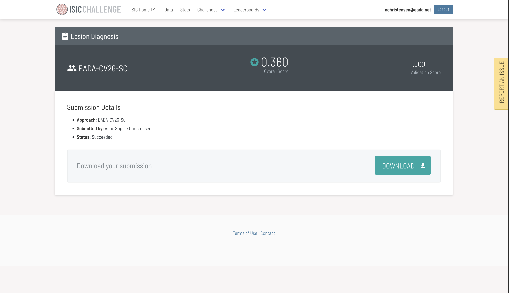

# MILK10k lesion classification — Computer Vision and Speech Recognition

Individual course project (EADA). The repository grows one session at a time:
Session 1 the setup and first EDA, Session 2 the extended EDA and a first data
pipeline, Session 3 / Milestone 1 a **leak-free, reproducible pipeline**,
Session 4 classical filters, Session 5 a classical ML baseline, Session 6 a
neural network on handcrafted features, Session 7 CNNs and transfer learning,
Session 9 / Milestone 4 ResNet-18 vs ViT-B/16, error analysis and a fairness check,
Session 10 / Milestone 5 the final 11-class model, `predict()` and the official
leaderboard submission. The scoreboard in section 6 is how every model is compared.

**Final result:** ViT-B/16, 11 classes — **official MILK10k leaderboard macro-F1
0.360** (team `EADA-CV26-SC`); local estimate 0.428. See section 8 and
[`model_card.md`](model_card.md).

## 1. What this project is

**Task.** Every lesion in MILK10k has two photos — one dermoscopic (through a
dermatoscope) and one clinical close-up. All models here predict the diagnosis
from the **dermoscopic photo only** (the course default; the clinical photo was
optional). Using both is the obvious next step.

- **Target for the analysis (Milestones 2–4):** `diagnosis_1` — Benign / Malignant / Indeterminate.
- **Target for the leaderboard (Milestone 5, mandatory):** the 11-class scheme in
  `training_gt.csv` (AKIEC, BCC, BEN_OTH, BKL, DF, INF, MAL_OTH, MEL, NV, SCCKA, VASC).

The prediction supports a doctor at triage, deciding whether a lesion needs a
biopsy. Missing a malignant lesion costs far more than an unnecessary check-up,
so the model is judged on macro-F1 and per-class recall, not accuracy.

**Dataset.** MILK10k — https://api.isic-archive.com/doi/milk10k/ (described in
*J Invest Dermatol*, doi 10.1016/j.jid.2025.06.1594), licence CC BY-NC,
attribution "MILK study team". 10,480 images / 5,240 lesions, exactly two images
per lesion.

**Goal of Milestone 1.** No model yet: a pipeline that loads and verifies the
data, decides the labels, splits it without leakage, preprocesses and augments it
defensibly, and feeds it in batches — all reproducible from one seed.

## 2. Setup and how to run

Python 3.11+. From the repository root:

```bash
python3 -m venv venv
source venv/bin/activate          # Windows: venv\Scripts\activate
pip install -r requirements.txt
```

**Where the data goes.** The dataset is downloaded to `data/milk10k/` by
`m1_data/Session1/session1.py` (~345 MB). The path is defined in exactly one place,
`common/config.py`. To keep the images elsewhere (Colab, for instance), set an
environment variable — no path is ever hard-coded in a script or a notebook:

```bash
export MILK10K_DIR="/path/to/milk10k"
```

**Commands.** Run from the repository root.

```bash
python m1_data/Session1/session1.py        # download the data + Session 1 EDA figures
python m1_data/Session1/practice_ex1.py    # Session 1 exercises
python m1_data/Session2/run_hw2.py         # Session 2 homework (EDA, processing, loader, visualiser)
python m1_data/run_milestone1.py           # Milestone 1: B1–B8, writes everything in outputs/
python m2_baseline/Session4/session4.py    # Session 4: filters, Gaussian blur, Canny vs Sobel
python m2_baseline/Session5/session5.py    # Session 5: classical ML baseline (features -> models -> test)
jupyter notebook m1_data/Session3/homework_part_a.ipynb   # Part A (or open it in VS Code)
jupyter notebook m3_deep/Session6/session6.ipynb          # Session 6: the MLP
jupyter notebook m3_deep/Session7/session7.ipynb          # Session 7: CNNs and ResNet-18
jupyter notebook m4_best_model/m4.ipynb                   # Milestone 4: run in Colab on a T4 GPU
jupyter notebook m5_final/m5_train.ipynb                  # Milestone 5: 11-class model, run in Colab on a T4 GPU
python m5_final/tune_thresholds.py                        # Milestone 5: official-style score + per-class thresholds
python m5_final/predict.py path/to/dermoscopic.jpg        # predict one image (needs m5_final/model_m5.pt)
python m5_final/make_submission.py --metadata data/milk10k_test/MILK10k_Test_Metadata.csv \
       --images data/milk10k_test/MILK10k_Test_Input       # the leaderboard file
```

**Using the final model.** `model_m5.pt` (~330 MB) is too big for git: produce it
with `m5_final/m5_train.ipynb`, or ask me for a copy, and put it in `m5_final/`.
Then, from Python:

```python
from m5_final.predict import predict
predict("path/to/dermoscopic.jpg")    # {"AKIEC": 0.01, "BCC": 0.83, ...}
```

`m1_data/run_milestone1.py --quick` skips opening every image (the slow check in
B1). The notebooks run top to bottom with "Restart & Run All".

## 3. Repository structure

```
.
├── README.md                     this file
├── model_card.md                 the final model: use, data, numbers, limits, how to reproduce
├── report.pdf                    the final report
├── requirements.txt              dependencies
├── .gitignore                    keeps images, venv, caches and model weights out of git
├── data/milk10k/                 the training dataset (downloaded, NOT committed)
├── data/milk10k_test/            the blind leaderboard test set (downloaded, NOT committed)
│
├── common/                       SHARED - code every milestone uses
│   ├── config.py                 paths, target, seed, image size, the 3 and 11 class lists
│   ├── milk10k.py                load_metadata(), available_subset()
│   └── viz.py                    show_grid(), plot_class_balance(), plot_batch_check()
├── src/                          SHARED - the Milestone 1 pipeline
│   ├── lesions.py                per-image metadata -> one row per lesion
│   ├── splits.py                 split_lesions(), split checks, fold-strategy comparison
│   ├── labels.py                 label map, class weights, sampler weights
│   ├── quality.py                label cross-checks, integrity check, data-quality report
│   ├── transforms.py             train_transform / eval_transform + why each augmentation is safe
│   └── datasets.py               MilkImageDataset, LesionDataset, DataLoaders
├── outputs/                      SHARED - the splits every model is trained and scored on
│   ├── splits/{train,val,test}.csv
│   ├── lesions.csv, label_map.json, class_weights.json
│   ├── image_size_summary.csv, data_quality_report.md, augmentations.csv
│   └── figures/
│
├── m1_data/                      MILESTONE 1 - data, EDA, the pipeline
│   ├── run_milestone1.py         runs B1–B8 end to end
│   ├── Session1/                 download + first EDA
│   ├── Session2/                 homework 2: metadata, colour, processing, loader
│   └── Session3/                 homework part A (notebook + PDF)
├── m2_baseline/                  MILESTONE 2 - classical baseline
│   ├── Session4/                 filters, Gaussian blur, Canny vs Sobel (written by hand)
│   └── Session5/                 features -> random forest; features.csv is reused by Session 6
├── m3_deep/                      MILESTONE 3 - deep learning
│   ├── Session6/                 MLP in PyTorch (data.py + session6.ipynb)
│   └── Session7/                 CNN from scratch + ResNet-18 transfer learning (session7.ipynb)
├── m4_best_model/                MILESTONE 4 - ResNet-18 vs ViT, error analysis, fairness
│   ├── m4.ipynb                  the notebook (Colab, T4 GPU)
│   ├── test_predictions.csv      final model's prediction for every test lesion
│   ├── fairness.csv              metrics by sex, age group and body site
│   ├── fairness_skin_tone.csv    metrics by skin_tone_class
│   ├── scoreboard.csv            every model of the project in one table
│   ├── figures/                  the most confident mistakes
│   └── model_m4.pt               final weights (~330 MB, NOT committed)
└── m5_final/                     MILESTONE 5 - final 11-class pipeline + leaderboard
    ├── pipeline.py               THE model + validation transform (used by everything below)
    ├── m5_train.ipynb            trains the 11-class ViT (Colab, T4 GPU)
    ├── predict.py                predict(image_path) -> 11 probabilities
    ├── tune_thresholds.py        official-style local score, per-class thresholds
    ├── make_submission.py        blind test set -> submission.csv
    ├── submission.csv            the file uploaded to the ISIC Challenge (479 lesions)
    ├── leaderboard.png           screenshot of the official result
    ├── results.json, test_per_class.csv, local_scores.csv, thresholds.json
    ├── figures/                  11-class confusion matrix
    └── model_m5.pt               final weights (~330 MB, NOT committed)
```

**Why this layout.** Anything more than one milestone uses lives at the top:
`common/`, `src/`, `outputs/` and `data/`. The splits in `outputs/` are used by
M2, M3, M4 and M5 alike, so they can't belong to any single milestone. Each
`mX_` folder holds one stage's work, in the order the course built it. Every
script finds the repository by walking up until it sees `common/config.py`, so
nothing depends on how deep a file sits.

## 4. Data handling rules

- **Not committed:** the images and the zip (`**/milk10k/`, `**/milk10k.zip`),
  the blind test set (`data/milk10k_test/`), the model weights (`model_m4.pt`,
  `model_m5.pt`, ~330 MB each), the virtual environment, `__pycache__`. Anyone can recreate the data by running
  `m1_data/Session1/session1.py`.
- **Committed:** all code, the split CSVs, the label map, the class weights, the
  quality report and the figures — they are small and they are the evidence for
  the reports.
- **Seed:** `config.SEED = 0`, used for the splits, the sampler and torch.
- **Splits created:** 29 September 2026, by `m1_data/run_milestone1.py`, written
  to `outputs/splits/`.

## 5. Key decisions so far

**Label strategy.** `diagnosis_1` keeps all three classes: Indeterminate is only
2.3 % of lesions, but it means "the doctor could not decide", which is exactly the
case a tool must not quietly call benign. For the 11-class stretch goal the five
rare classes (DF, INF, VASC, BEN_OTH, MAL_OTH) are kept rather than merged —
merging would put benign and malignant lesions under one label — and handled with
class weights and a weighted sampler. The mapping is in `outputs/label_map.json`.

**Split design.** Splitting is done at **lesion level** with
`StratifiedGroupKFold` (70 / 15 / 15), then the images are attached. A naive
image-level split puts one photo of a lesion in train and the other in test: in
this dataset that leaks about 89 % of test lesions. Checks run on every split: no
lesion in two splits, exactly 2 images per lesion, class proportions per split
against the global mix.

**Preprocessing.** 224×224 (all images are 600×450, so every image is downscaled,
never upscaled), ImageNet normalisation. The Milestone 1 pipeline can use both views of a lesion
and average them back into **one prediction per lesion**
(`datasets.aggregate_predictions`), because the lesion is what a doctor decides
about. From Session 5 on, every model uses the **dermoscopic view only**, one
image per lesion, so all scoreboard rows see exactly the same input.

**Augmentation.** Flips, small rotations and crops (scale ≥ 0.85, so the lesion
cannot be cropped out), plus mild brightness and contrast jitter. **Hue jitter is
set to 0**: A3.5 in the notebook measures that a hue shift moves colour more than
the gap between Benign and Malignant, so it would destroy the signal it is meant
to make robust. `eval_transform` is deterministic and is asserted to be so.

**Imbalance.** Measured on the train split only: 69 % of lesions are Malignant,
and in the 11-class scheme BCC outnumbers MAL_OTH by about 280 to 1. Handled with
both class weights (`outputs/class_weights.json`) and a `WeightedRandomSampler`.
Because MILK10k is biopsy-enriched, any accuracy measured here overstates
real-world performance — details in the Milestone 1 report.

## 6. Results so far — the scoreboard

Every number is **macro-F1**, not accuracy: about 72 % of the test set is
Malignant, so a model that always answers "Malignant" scores 0.717 accuracy while
learning nothing. The same model scores 0.278 macro-F1, and that is the floor.

All models use the same lesion-level split from Session 3 and the dermoscopic
photo of each lesion, so the rows are comparable. Validation chooses; test is
scored once.

| Session | Model | Validation | Test |
|---|---|---|---|
| 5 | majority (always Malignant) | 0.272 | 0.278 |
| 5 | random forest, 24 histogram features | 0.511 | 0.525 |
| 6 | MLP 33-64-3, handcrafted features | 0.463 | 0.483 |
| 6 | MLP 3072-64-3, raw 32x32 pixels | 0.524 | 0.456 |
| 7 | CNN from scratch | 0.520 | — |
| 7 | ResNet-18 frozen + linear head | 0.563 | — |
| 7 | ResNet-18, layer4 fine-tuned | 0.638 | — |
| 7 | **ResNet-18, layer3 + layer4 fine-tuned** | **0.642** | **0.590** |
| 7 | ResNet-18, all layers fine-tuned | 0.529 | — |
| M4 | ResNet-18 frozen + linear head (all 3,667 lesions) | 0.537 | 0.532 |
| M4 | ViT-B/16 frozen + linear head | 0.613 | 0.589 |
| M4 | ResNet-18, layer3 + layer4 fine-tuned (rerun) | 0.648 | 0.605 |
| M4 | **ViT-B/16, last 2 blocks fine-tuned** | **0.663** | **0.589** |

These rows are all **3-class** (`diagnosis_1`). The 11-class model submitted to the
leaderboard is scored separately in section 8, since its numbers are not comparable.

**Final model (Milestone 4): ViT-B/16 with its last 2 encoder blocks and a new
head fine-tuned — validation 0.663, test 0.589.** It was chosen on validation.
On test the ResNet-18 recipe scored 0.590 (Session 7) and 0.605 (Milestone 4 rerun):
two identical runs differ by about 0.015, so on 787 lesions, with only 17
Indeterminate, gaps of that size are noise. All are about 2.1x the majority floor.

Three things the table shows:

- **Transfer learning is what moved the number.** A CNN trained from scratch on
  3,667 lesions reaches 0.520, barely past the Session 5 forest. The same
  architecture pretrained on ImageNet and partly fine-tuned reaches 0.642.
- **Fine-tuning everything made it worse** (0.529 vs 0.642). 11.7 million weights
  on 3,667 lesions is too much freedom; the early layers already hold the general
  edges and textures that transfer fine, so letting them move only loses them.
- **`layer3 + layer4` barely beat `layer4` alone** (0.642 vs 0.638) for about 2
  million extra trainable weights. On 786 validation lesions that gap is noise.

The drop from validation to test (0.642 -> 0.590) is the usual cost of having
chosen the configuration on validation, and is the honest number to quote.

## 7. Milestone 4 — what the final model gets wrong

Details and figures are in `m4_best_model/m4.ipynb`, sections 4–6.

- **Frozen backbones, same head: ViT-B/16 beats ResNet-18** (0.613 vs 0.537 on
  validation). Fine-tuned, the gap closes (0.663 vs 0.648). On test the ResNet
  is slightly higher (0.605 vs 0.589), but the choice is made on validation, and a gap
  that size is run-to-run noise (the same ResNet recipe gave 0.590 in M3).
- **The model misses melanoma.** 35 of the 63 test melanomas were called Benign
  (56 %), against 31 of 401 basal cell carcinomas (8 %). The most confident
  misses look like ordinary brown moles.
- **False alarms are pale seborrhoeic keratoses.** 44 of 77 BKL were called
  Malignant; most are flat and pink-red, like the BCCs that make up 71 % of the
  Malignant class. The model seems to lean on colour: brown = benign, pink =
  malignant.
- **Indeterminate is hard by nature.** All 17 Indeterminate lesions are AKIEC,
  and 27 Malignant lesions are AKIEC too; the pathologist decides between them,
  not the photo. Indeterminate F1 is 0.23.
- **Fairness.** Malignant recall is 0.61 for patients under 50 and 0.87–0.88
  for older ones; 13 of the 14 melanomas in under-50s were missed. Women 0.80,
  men 0.87: for women the model misses more melanomas (17 of 27) *and* more
  BCCs (13 % vs 7 %), so that gap is not explained by melanoma alone. Body sites are
  similar (0.80–0.90). Skin tone (`skin_tone_class` in `supplements/training_input.csv`):
  recall is lowest for tone 2 (0.43), mostly missed melanomas again; tones 0–1 are too small to judge.
- **Next:** the biggest problem is melanoma. More melanoma examples, a
  higher weight for it, or training on the 11-class target are the obvious
  things to try.

## 8. Milestone 5 — final 11-class model and the official leaderboard

The leaderboard only accepts 11 classes, so the Milestone 4 winner was
**retrained once with 11 outputs** on the same split — same backbone (ViT-B/16),
same layers fine-tuned, same recipe; only the labels (`training_gt.csv`) and the
last layer change. Details, numbers and limits: [`model_card.md`](model_card.md).

| 11-class ViT-B/16 | Validation | My test split | Official blind test |
|---|---|---|---|
| macro-F1, argmax | 0.373 | 0.405 | — |
| macro-F1, official rule (each class ≥ 0.5) | 0.371 | 0.387 | — |
| macro-F1, official rule + tuned thresholds | 0.435* | **0.428** | **0.360** |
| always "BCC" | — | 0.068 | — |

\* optimistic: the thresholds were tuned on validation.

- **The official metric is not the usual macro-F1.** It binarises every class at
  0.5. With 11 softmax outputs a rare class seldom reaches 0.5, so one threshold
  per class was tuned on validation and the probabilities rescaled to put it at
  0.5 (`tune_thresholds.py`): 0.387 → 0.428 on my test split.
- **One pipeline everywhere.** The model and the validation transform are defined
  once, in `m5_final/pipeline.py`; the notebook checks that `predict()` gives the
  same probabilities as the notebook (difference ~1e-7).
- **Official score 0.360 vs local 0.428.** My test split has no MAL_OTH, so 0.428
  averages 10 classes, the leaderboard 11; the model never predicts MAL_OTH (7
  training examples), so that class can only score 0 (0.428 × 10/11 ≈ 0.39). The
  rest: rare classes with a handful of lesions among 479, thresholds tuned on few
  validation lesions, and new patients.
- **Strong where the data is**: BCC F1 0.81, NV 0.74. **Weak where it isn't**:
  INF 0.00, BEN_OTH 0.05, and melanoma only 0.48 — the same weakness Milestone 4 found.
- **Format note:** the course slides give the first column as `lesion`; the ISIC
  system rejected that and requires `lesion_id`. `make_submission.py` writes `lesion_id`.


